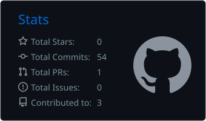
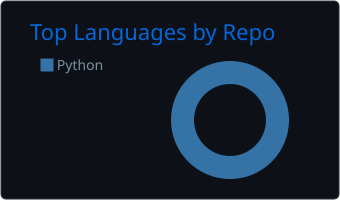

<p align="center">
  
</p>

```text
     ██╗██╗    ██╗ █████╗ ██╗      █████╗ ███╗   ██╗████████╗██╗  ██╗
     ██║██║    ██║██╔══██╗██║     ██╔══██╗████╗  ██║╚══██╔══╝██║  ██║
     ██║██║ █╗ ██║███████║██║     ███████║██╔██╗ ██║   ██║   ███████║
██   ██║██║███╗██║██╔══██║██║     ██╔══██║██║╚██╗██║   ██║   ██╔══██║
╚█████╔╝╚███╔███╔╝██║  ██║███████╗██║  ██║██║ ╚████║   ██║   ██║  ██║
 ╚════╝  ╚══╝╚══╝ ╚═╝  ╚═╝╚══════╝╚═╝  ╚═╝╚═╝  ╚═══╝   ╚═╝   ╚═╝  ╚═╝
                  [ security engineer :: offense informs defense ]
```

```bash
jwalanth@kali:~$ whoami
```

I break web apps, APIs, and AI systems before attackers get the chance, then help the people who built them make them stronger. Authentication, authorization, and business-logic flaws are what I go looking for. Lately I've also been feeding prompts to LLMs to find out what they'll give away.

```bash
jwalanth@kali:~$ cat /etc/motd
```

```text
  "Scanners find what's known. Curiosity finds what's missed."
```

```bash
jwalanth@kali:~$ nmap -sV -p- jwalanth.local
```

```text
Starting Nmap scan against jwalanth.local
Host is up (0.0013s latency).

PORT      STATE  SERVICE         VERSION
22/tcp    open   automation      python · bash · javascript
80/tcp    open   web-appsec      burp-suite-pro · owasp-zap · ffuf · nikto · postman
443/tcp   open   api-security    rest · graphql · websockets · bola/idor hunting
1337/tcp  open   offensive-ops   nmap · metasploit · nuclei · hydra · hashcat · linpeas
3000/tcp  open   code-review     semgrep · sonarqube · secure code review
5601/tcp  open   blue-team       splunk · siem · mitre att&ck · wireshark
6443/tcp  open   cloud           aws · azure · terraform · ansible · jenkins · okta
8080/tcp  open   ai-red-team     promptfoo · garak · prompt injection · jailbreaks
9999/tcp  open   frameworks      owasp top 10 · owasp api top 10 · stride · nist 800-53 · zero trust

Nmap done: 1 host up · 0 findings left unreported
```

<p align="center">
  
  
  
  
  
</p>

```bash
jwalanth@kali:~$ ls -la ~/.badges
```

```text
-r--r--r--  1 jwalanth  certified   CompTIA_Security+
-r--r--r--  1 jwalanth  certified   eJPTv2
-r--r--r--  1 jwalanth  certified   TryHackMe_Jr_Penetration_Tester
```

<!--```bash
jwalanth@kali:~$ ./stats --live
```

<p align="center">
  
  
</p>
-->

```bash
jwalanth@kali:~$ ssh connect@jwalanth
```

<p align="center">
  <a href="https://linkedin.com/in/jwalanth61"></a>
  <a href="https://medium.com/@jwalanth61"></a>
  <a href="mailto:jwalanth.e.61@gmail.com"></a>
</p>

```bash
jwalanth@kali:~$ exit
[*] session closed. stay curious, patch often.
```
